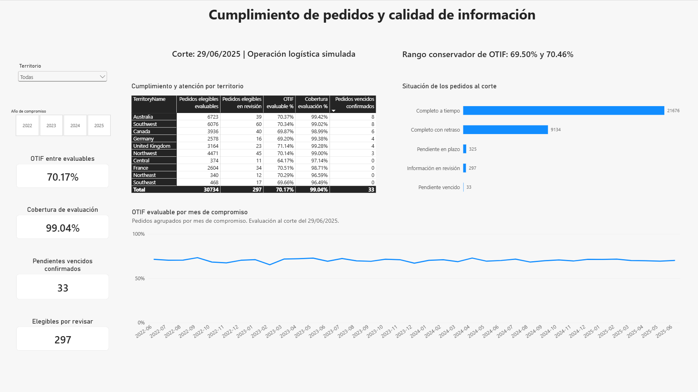
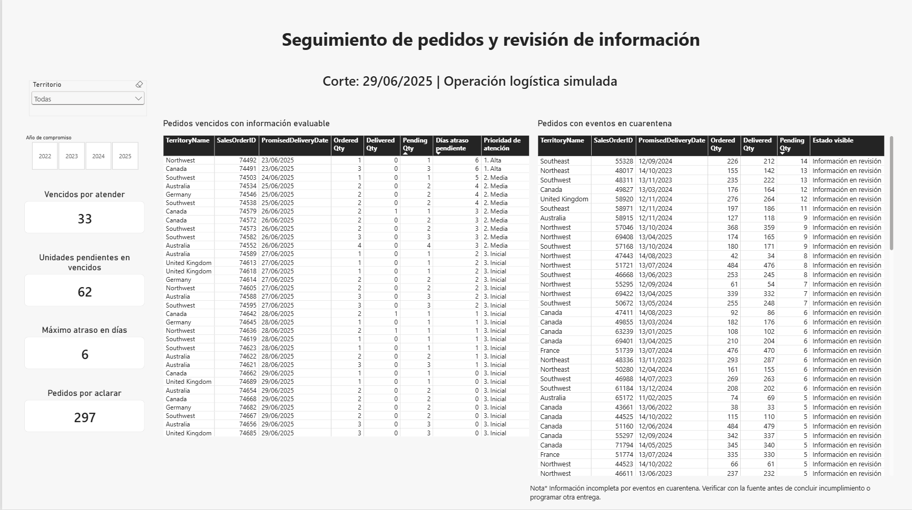
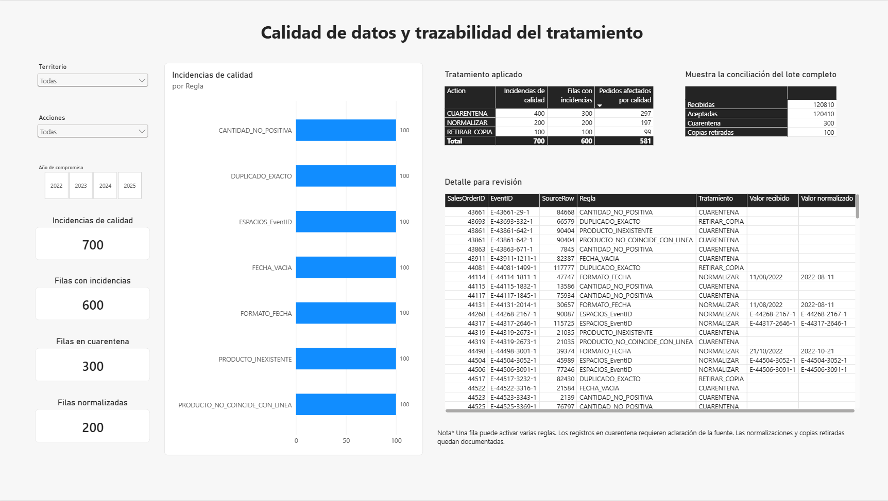

# Cumplimiento de pedidos y calidad de información

**Un proyecto de análisis de datos para distinguir retrasos logísticos de problemas de información.**

Autor: **Jared Flores Orihuela** · SQL Server · Python · Power BI · Excel · n8n · Power Automate

Caso simulado basado en AdventureWorks2025. Corte: **29/06/2025**, al final del día.
Las promesas, entregas e incidencias son sintéticas; los resultados no describen una empresa real.

Permite distinguir los pedidos vencidos confirmados de aquellos cuya información requiere revisión.

Presenta las incidencias detectadas, el tratamiento aplicado y la conciliación del lote recibido.

## Problema y decisión

Una distribuidora necesita conocer qué pedidos se entregaron completos y a tiempo (OTIF),
cuáles requieren atención y cuáles no pueden evaluarse porque su información es inconsistente.
Contar una entrega inválida como incumplimiento puede llevar a reclamar al transportista o
programar otra entrega sin fundamento.

La solución valida los datos, conserva las incidencias, separa los pedidos por aclarar y muestra
el cumplimiento junto con su cobertura de evaluación. Un piloto en SharePoint permite asignar
y cerrar revisiones con responsable, fecha y comentario.

## Resultados del escenario

| Indicador | Resultado |
|---|---:|
| Pedidos analizados | 31.465 |
| Líneas de pedido | 121.317 |
| Pedidos elegibles para OTIF | 31.031 |
| Elegibles con información evaluable | 30.734 |
| Pedidos que cumplen OTIF confirmados | 21.567 |
| OTIF entre evaluables | 70,17 % |
| Cobertura de evaluación | 99,04 % |
| Rango conservador de OTIF de los elegibles | 69,50 %–70,46 % |
| Pedidos con información por revisar | 297 |
| Pendientes vencidos confirmados | 33 |
| Unidades pendientes en esos vencidos | 62 |
| Incidencias de calidad / filas afectadas | 700 / 600 |

El rango conservador representa la incertidumbre por los 297 pedidos no evaluables; **no es un
intervalo de confianza estadístico**. Los 21.676 pedidos del gráfico “Completo a tiempo” incluyen
pedidos cuyo compromiso todavía no vence al corte; por eso no son el numerador OTIF de 21.567.

La conciliación del archivo recibido es:
**120.810 = 120.410 aceptadas + 300 en cuarentena + 100 copias retiradas**.
Las 200 normalizaciones están dentro del procesamiento; no se suman como otra disposición.

## Cómo funciona

1. Se exportan pedidos, líneas, productos, clientes y territorios desde SQL Server a cinco CSV.
2. Python valida los originales y genera el escenario logístico y errores controlados.
3. Al ejecutar manualmente n8n, este comprueba el servicio Python y solicita procesar el archivo de entregas.
4. Python valida, normaliza, retira copias y separa cuarentena; guarda resultados por ejecución.
5. Si el contenido es nuevo y cumple los controles, publica las entregas aceptadas, pedidos por revisar
   e incidencias en SQL Server dentro de una transacción.
6. Si ese contenido ya está publicado y sigue vigente, devuelve **YA_PUBLICADO** sin volver a cargarlo.
7. El usuario pulsa **Actualizar** en Power BI Desktop para consultar los resultados.
8. Los casos piloto se registran manualmente en SharePoint y se gestionan mediante dos flujos de Power Automate.

~~~mermaid
flowchart TD
    A["CSV exportados + entregas simuladas"] --> B["Python: validación y limpieza"]
    N["n8n: ejecución manual"] --> B
    B --> C["Aceptadas y bitácora"]
    B --> D["Cuarentena y pedidos por revisar"]
    C --> E["SQL Server: publicación controlada"]
    D --> E
    E --> F["Power BI: actualización manual"]
    E --> G["Excel: conciliación de muestra"]
    D -. "Selección manual de casos" .-> H["SharePoint + Power Automate"]
~~~

## Qué demuestra cada herramienta

| Herramienta | Trabajo realizado |
|---|---|
| SQL Server | Extracción, integridad relacional, vistas analíticas, transacciones y auditoría |
| Python | Perfilado, simulación reproducible, reglas de calidad, conciliación y servicio |
| Power BI | Modelo con dimensiones compartidas, cumplimiento, seguimiento y calidad |
| Excel / Power Query | Conciliación de fórmulas sobre diez pedidos contra resultados SQL |
| n8n | Coordinación manual y respuesta ante éxito, reproceso y fallo |
| Power Automate / SharePoint | Inicio y cierre de revisión con condiciones de estado |

La IA asistió la construcción y documentación. El autor ejecutó y contrastó resultados.
[Registro y límites de la asistencia](docs/ASISTENCIA_IA.md).

## Recorrido del portafolio

- [Resultados y definiciones](docs/METODOLOGIA.md).
- [Galería de evidencias](docs/EVIDENCIAS.md).
- [Reproducir y operar](docs/REPRODUCCION.md).
- [Diccionario de archivos](docs/DATOS.md).
- [Validaciones y límites de la revisión](docs/VALIDACION.md).
- [Diseño de los flujos de revisión](automation/power-automate/README.md).
- [Mejoras futuras](docs/MEJORAS.md).
- [Informe Power BI](powerbi/Cumplimiento_Pedidos_v1.pbix).
- [Conciliación Excel](excel/Conciliacion_Pedidos_v1.xlsx).

Los archivos PBIX y XLSX son descargables; este repositorio no aloja un informe interactivo.

## Alcance de esta versión

Es un MVP local de corte fijo. La extracción inicial es manual; la publicación sustituye el
estado logístico vigente, no es una carga incremental ni una solución de cierres mensuales.
Los maestros y promesas deben permanecer iguales a los cargados inicialmente.
SharePoint no está sincronizado con SQL: cerrar una revisión no corrige la fuente ni cambia OTIF.
Las capturas de Power Automate se revisaron, pero no se entregaron paquetes importables de esos flujos.

No se atribuyen ahorros de dinero, reducción de tiempos ni mejoras reales de servicio sin medición.

## Fuentes

AdventureWorks es una base de ejemplo de Microsoft. Véanse [procedencia y avisos](THIRD_PARTY_NOTICES.md).
La entrega incluye extractos sin nombres ni contactos de clientes y los datos sintéticos del experimento.
